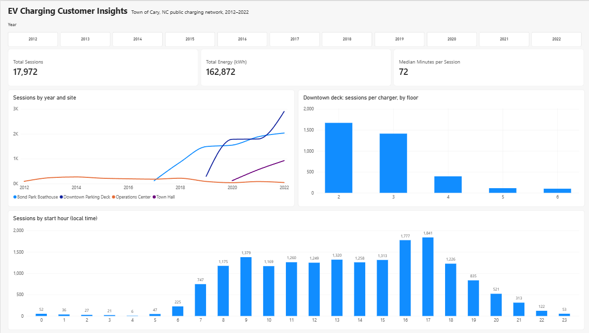

# EV Charging Customer Insights — Town of Cary, NC

An analysis of 10 years of public EV charging sessions. The goal: understand how customers use the charging network, where demand is growing, and what the network operator should do next.

**Tools:** Microsoft SQL Server (T-SQL), Power BI, Git/GitHub
**Data:** 20,142 charging sessions, April 2012 – January 2023, Town of Cary Open Data (see [Data source](#data-source))


*Power BI dashboard: all years. A year filter updates the cards, the floor chart and the hourly chart. The trend line always shows every year.*

---

## Business questions

1. How fast is EV charging demand growing?
2. Which sites carry the load?
3. When do customers charge, and did that change as demand grew?
4. How long do customers stay, and how much energy do they take?
5. What should the operator do next?

## Key findings

**1. Demand grew 20× in five years.**
Sessions rose from 297 in 2017 to 5,907 in 2022. The growth came in two stages:

- **2018–2020: new sites.** 2018 was Bond Park's first full year (opened September 2017), and 2020 was the downtown deck's first full year (opened late 2019). Most early growth came from more places to charge.
- **2021–2022: more demand at the same sites.** No new sites opened, but use kept growing — the deck rose 62% and Town Hall 65% in 2022. This is true demand growth on about 10 chargers.

| Year | Sessions | Energy (kWh) | Growth |
|------|---------:|-------------:|-------:|
| 2018 | 1,080 | 6,553 | +264% |
| 2019 | 1,870 | 15,386 | +73% |
| 2020 | 3,486 | 33,312 | +86% |
| 2021 | 4,322 | 40,712 | +24% |
| 2022 | 5,907 | 58,040 | +37% |

**2. Two sites carry 84% of sessions.**
In 2022, the Downtown Parking Deck had 49% of sessions and Bond Park Boathouse had 35%. Town Hall customers stay longer (153 min on average) and take more energy per visit (13 kWh).

**3. The 4–6 PM peak faded as demand grew.**
Across all years, 20% of sessions start between 4 and 6 PM (local time). But that number comes mostly from the early years: in 2017, 48% of sessions started then. From 2019 on, only about 16% do, and demand spreads across the day.

| Year | 10 AM–4 PM (6 h) | 4–6 PM (2 h) | 6–10 PM (4 h) |
|---|---:|---:|---:|
| 2017 | 28% · 4.7%/h | 48% · 24.1%/h | 6% · 1.5%/h |
| 2019 | 49% · 8.2%/h | 16% · 8.1%/h | 10% · 2.5%/h |
| 2022 | 43% · 7.1%/h | 16% · 8.2%/h | 17% · 4.3%/h |

The bands follow parts of the day, so they have different lengths. Each cell shows the band's share of sessions and its share **per hour**. By total, 10 AM–4 PM is the main charging window. Hour for hour, 4–6 PM is still slightly busier, but the gap is small since 2019. The hourly chart in the dashboard shows all 24 hours with no grouping.

Evening charging (6–10 PM) doubled from about 10% to about 20% starting in 2020. Note: these numbers count session *starts*. A session that starts at 3 PM still draws power during the 4–6 PM grid peak.

**4. Short visits are frequent, long visits use the energy.**

| Session length | % of sessions | % of energy |
|---|---:|---:|
| Under 1 hour | 41% | 14% |
| 1–3 hours | 43% | 40% |
| 3–8 hours | 14% | 37% |
| 8+ hours | 1% | 9% |

Sessions of 3 hours or more are 16% of visits but 46% of the energy.

**5. Each site serves a different kind of customer (likely segments).**
The day-of-week pattern at each site is stable across 2019–2022:

| Site | Pattern (sessions per active day) | Likely segment |
|---|---|---|
| Bond Park Boathouse | Weekend-heavy: 1.2–1.8× weekdays every year (7.6 vs 5.8 in 2022) | Leisure visitors |
| Downtown Parking Deck | Even all week in 2022 (8.1 vs 8.1); weekend-heavy in 2019 and 2021 | Mixed: work days + dining and events |
| Town Hall | Even all week (about 2–3 per day) | Visitors and staff |
| Operations Center | Weekday-heavy: only 5–12% of sessions on weekends | Workplace |

Use per day grew at every site from 2019 to 2022, on weekends and on weekdays. The 2020 dips are small (5–14%) and may be normal variation; COVID shows more clearly as stalled growth — Bond Park grew 73% in 2019 but only 4% in 2020. The deck's weekday dip in 2021 matches months-long outages on three of its busiest chargers (see finding 7).

**The downtown deck jumped in 2022:** weekend use rose 45% (5.6 → 8.1 per day) and weekday use rose 69% (4.8 → 8.1). Two causes likely worked together: chargers that were down in 2021 came back (P2-1 and P2-2 in January 2022, P3 East in June 2022), and demand kept growing. The data cannot separate the two exactly.

> **Assumption:** The data has no information about who the customers are. These segments are a general assumption made from *when* people charge and *where* each site is (for example, Bond Park is a town park with a lake and boat rentals). They are a starting point to test with customer data or surveys, not a proven result.

**6. Lower floors get far more use in the parking deck.**
In 2022, each charger on floors 2–3 had about 1.7–1.9 sessions per day. Floors 5–6 had less than 0.2, which is about 10 times less. Some upper-floor chargers had long periods with no sessions. If those periods were outages, the difference is about 6 times (right column). The data cannot separate outages from low demand, but the lower floors get much more use in both cases.

| Deck floor | Sessions per day (all days) | Sessions per day (likely working days) |
|---|---:|---:|
| 2 | 0.59–2.37 | 0.77–2.63 |
| 3 | 0.73–1.71 | 1.10–1.88 |
| 4 | 0.35 | 0.46 |
| 5 | 0.10 | 0.26 |
| 6 | 0.09 | 0.37 |

Sessions on floors 5–6 were longer (median about 3 hours, compared with 1–1.5 hours on floors 2–3). But there were too few sessions (about 60 per floor in 2022) to draw a conclusion.

**7. Some chargers were likely out of service for months.**
The data has no status records, so outages cannot be confirmed. But a busy charger that goes silent for months is most likely down. I flagged a gap as a *likely outage* when it was 30+ days **and** at least 10 times the charger's normal gap between uses.

- **Deck P5 and P6** were silent 62–77% of their time in service. When they did work, customers used them every 2–4 days.
- **Deck P3 East** was silent for 388 days (May 2021 – June 2022), and **Deck P2-1** for 244 days.
- **Ops Center** was a steady weekday charger (about 200 sessions a year, 2012–2018). From mid-2019 it had five gaps of 68–133 days, and it stopped in December 2021. Its decline came mostly from downtime, not from a lack of drivers. On days it was used, it still had about 1.2 sessions, the same as in its busy years. The old unit stopped in December 2021, and a fast charger started at the same address in May 2022. (Some 2020 gaps also match the COVID lockdown.)

**8. COVID hit downtown hard, but not the park.**
In spring 2020 the downtown deck dropped from 243 sessions in February to 47 in April (−81%). It came back slowly: 65% of normal by August and 78% by December. Bond Park went the other way: April–May 2020 had *more* sessions than April–May 2019 (136 vs 104, 157 vs 143), likely because outdoor recreation continued.

Two details matter:
- **Few days had zero use.** The deck had only 3 zero-use days in April 2020. The drop came from fewer sessions per day, not from empty days.
- **Customer value changed, not only the count.** After the deck reopened (July–September 2020), each session took more energy (about 13 kWh vs 9–10) and lasted longer (about 150 min vs 110). Fewer customers came, but each one used the charger more. At Bond Park in April 2020, sessions were shorter (66 min, 5.9 kWh).

The cause is an assumption: the timing matches the spring 2020 lockdown, but the data does not record why customers changed.

## Recommendations

These follow from the findings. They are proposals to test, not proven results.

1. **Watch the evening shift.** Evening charging doubled after 2020. Measure how much charging is *in progress* during the 4–6 PM grid peak before designing off-peak pricing or managed charging.
2. **Expand downtown first — on the lower floors.** The deck carries half the network's demand and has the highest daily peaks. New chargers on floors 2–3 should get far more use than chargers on floors 5–6. Better signs to the upper-floor chargers are a low-cost test.
3. **Manage long sessions.** A time limit or an idle fee after charging ends can free ports for more customers. (This data records charging time only, not total plug-in time — a next step is to get plug-in data to measure idle time directly.)
4. **Plan each site around its likely segment.** Schedule Bond Park maintenance on weekdays, keep the Ops Center reliable on work days, and give the all-week downtown deck the most capacity.
5. **Track charger uptime.** Measure the % of days each charger works, and alert when a normally busy charger has no sessions for 2+ weeks. Long outages lose customers, and the upper-floor chargers lose the most.

## Data cleaning

| Issue | What I did |
|---|---|
| Text dates and durations | Converted to `datetime` and minutes in a view (`v_sessions`). |
| Invalid sessions | Removed 2,132 rows with zero energy or zero duration. 18,010 valid sessions remain. |
| Timestamps in UTC | Converted to US Eastern time, with daylight saving time, for hour-of-day analysis. |
| Station renames | The network renamed its stations around August 6, 2021. Old names stop and new names start within the same days at the same addresses. I grouped the 22 station names into 4 physical sites with a lookup table (`dim_site`). |
| Partial years | 2012 starts in April and 2023 has only 3 days. Year trends exclude 2023. |

## Repository structure

```
sql/
  01_load_and_clean.sql   create table, load CSV, clean view
  02_sites.sql            site lookup table + analysis view for Power BI
  03_analysis.sql         one query per business question
data/
  ev_charging_sessions.csv
powerbi/
  EV_Charging_Dashboard.pbip   Power BI project (open in Power BI Desktop)
images/                        dashboard screenshots
```

## How to run

1. Install SQL Server Express and SQL Server Management Studio (SSMS).
2. Run `sql/01_load_and_clean.sql`. Change the file path in the `BULK INSERT` line first.
3. Run `sql/02_sites.sql`.
4. Run `sql/03_analysis.sql`.
5. Open `powerbi/EV_Charging_Dashboard.pbip` in Power BI Desktop and click **Refresh**. It connects to `localhost\SQLEXPRESS`, database `EV_Project`.

## Data source

Town of Cary, North Carolina — Open Data Portal, EV charging station sessions.
<!-- TODO: add the exact dataset URL and license -->
